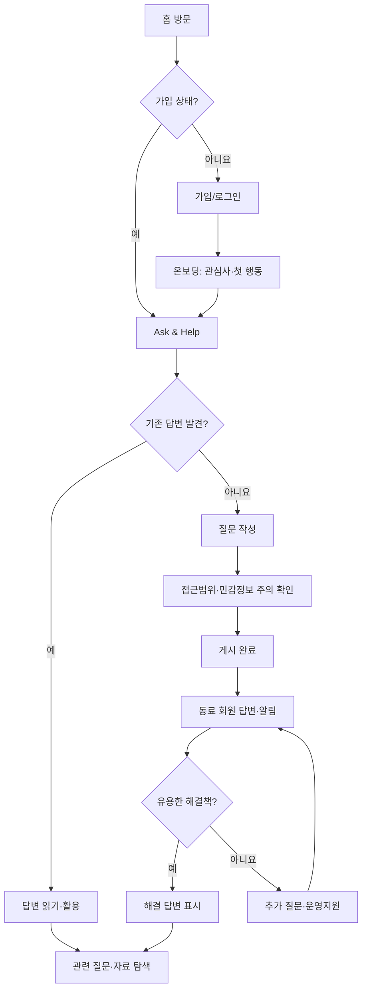

# Global AI Mission Community — UX/UI 상세 설계서

> **문서 종류:** 화면 정의서(Screen Specification) · 정보구조(IA) · 사용자 흐름 · 디자인 시스템 · 인터랙션 명세
> **버전/작성일:** v1.0 / 2026-11-12
> **상위 기준 문서:** `기획서.md` (GAMC 서비스 전략·MVP 초안, v1.0)
> **범위:** 반응형 웹(모바일·데스크톱) / 한국어·영어 UI / 방문자·회원·운영진
> **상태:** 구현 전 제안·검토용. 운영 주체·브랜드·보안·플랫폼·예산은 미확정.
> **표기:** **[원 기획]** 기존 기획서 직접 반영 · **[디자인 제안]** 본 문서 신규 구체화 · **[결정 필요]** 운영/보안/기술 승인 후 확정

---

## 1. 설계의 핵심

### 1.1 목표

GAMC는 **전 세계의 사역자·AI 전문가·교육자·창작자가 배우고, 질문하고, 서로 돕고, 안전하게 협력하도록 돕는 관계 중심 공동체**다. 사이트는 회원의 문제를 해결하고 신뢰를 쌓는 경로를 제공해야 한다. 화려한 AI 기능이나 SNS형 인기 경쟁을 첫 경험으로 삼지 않는다.

**핵심 약속:** “나의 질문이 존중받고, 도움이 되는 사람을 만나며, 함께할 일을 발견할 수 있다.”

**1순위 UX 시나리오:** `가입 → 환영 → 질문 작성 → 첫 답변 → 해결 확인 → 다른 회원 돕기`.

**차순위 UX 시나리오:** `공개 자료 탐색 → 유용한 자료 발견 → 가입/질문/행사 연결` 및 `프로젝트 발견 → 참여 의사 → 승인 기반 협력`.

### 1.2 설계 원칙 8개

1. **사람 먼저:** 숫자·기술·권위보다 인물의 안전과 존엄을 존중한다.
2. **한 화면 한 가지 주요 행동:** 특히 가입 직후에는 단 하나의 명확한 다음 단계를 보여준다.
3. **질문이 중심:** 홈과 커뮤니티의 주 CTA는 `질문하기` 또는 `도움주기`다.
4. **조용한 참여를 존중:** 자기소개·실명 공개·프로필 완성을 강요하지 않는다.
5. **보호적 기본값:** 연락처·정확한 위치·실명 비공개, 고위험 자료는 업로드하지 않는다.
6. **원문 보존:** 외국어 게시물은 원문을 표시하고 향후 기계번역을 명확히 표기한다.
7. **지식의 축적:** 유용한 답변은 해결된 Q&A와 검토된 자료로 다시 찾을 수 있다.
8. **가벼운 접근:** 느린 모바일 네트워크에서 이미지 없이도 주요 과업이 완수된다.

### 1.3 자료에서 가져온 설계 논리

| 개념(원 기획의 연구 기반) | 설계에서 확인되는 행동 |
|---|---|
| Spinks, *Social Identity Cycle*: 정체성→참여→인정 | 가치 이해 → 작은 첫 행동 → 실제 사람의 답변과 감사 |
| Spinks, *Commitment Curve* / 참여 여정 | 둘러보기→질문/반응→답변/자료→멘토/리더 |
| Spinks, *SPACES* (비영리 재해석) | 초기 집중은 **Support(서로 돕기) + Contribution(기여하기)** |
| Vogl, *Boundary* / *Initiation* | 접근 경계와 환영 흐름을 일관되게 제시 |
| Vogl, *Rituals* / *Stories* | 매주 질문·매월 사례·동의받은 협력 이야기 |
| Vogl, *Inner Rings* | 기여 역할은 특권 계층이 아니라 섬김의 책임으로 표시 |

**주의:** 이 표는 책의 이론을 사이트에 **응용**한 것이며, 아래의 메뉴·화면·색상은 저자들의 직접 지침이 아니다.

---

## 2. 메뉴·경로·접근권한

### 2.1 전체 IA

```text
Global AI Mission Community
├─ /                         Home · 가치·질문/자료/행사 진입
├─ /community                Community · 전체 대화
│  ├─ /community/general     Introductions & General
│  ├─ /community/help        Ask & Help
│  ├─ /community/collaborate Collaborate
│  ├─ /community/t/:id       대화/질문 상세
│  └─ /community/new         글·질문 작성 [회원]
├─ /resources                Resources · 검토된 자료
│  └─ /resources/:slug       자료 상세
├─ /events                   Events · 포럼·모임
│  └─ /events/:slug          행사 상세
├─ /projects                 Projects · 안전한 협력 안내
│  └─ /projects/:slug        프로젝트 소개 및 참여 요청
├─ /about                    About · 목적·가치·운영팀
├─ /search                   통합 검색(권한별 결과)
├─ /join                     가입
├─ /sign-in                  로그인/인증 안내
├─ /welcome                  온보딩(가입 직후)
├─ /me                       My Space · 내 활동
│  ├─ /me/profile            프로필 편집
│  ├─ /me/notifications      알림함
│  ├─ /me/preferences        언어·알림·공개설정
│  └─ /me/account            계정·내보내기·탈퇴 요청
├─ /guidelines               공동체 규칙
├─ /privacy                  개인정보 안내
├─ /safety                   안전·신고 안내
├─ /help                     사용 도움말
├─ /report/:target           신고 접수 [회원]
├─ /admin                    운영 개요 [운영진]
│  ├─ /admin/reports         신고 큐
│  ├─ /admin/reports/:id     신고 상세·판단 기록
│  ├─ /admin/content         자료·행사·프로젝트 검토
│  ├─ /admin/members         회원/권한 관리
│  ├─ /admin/insights        커뮤니티 건강 지표
│  └─ /admin/audit           관리자 조치 이력
└─ /404                      찾을 수 없는 페이지
```

- **1차 상단 메뉴:** `Community / Resources / Events / Projects / About`; 홈은 로고 클릭.
- **헤더 공통:** 로고, 5개 메뉴, 검색, 언어 토글(KO/EN), `가입` 또는 프로필/알림.
- **회원 메뉴:** `내 공간 / 프로필 / 알림 / 설정 / 로그아웃`.
- **운영 화면:** 승인된 운영진에만 링크 노출, 직접 URL 접근에도 서버에서 권한 검사.
- **원 기획의 3개 커뮤니티 공간**만 P0에 개설한다. 세부 주제는 태그로 처리한다.

### 2.2 화면 권한 매트릭스

| 정보/행동 | 방문자 | 일반 회원 | 기여/멘토 | 운영자 | 관리자 |
|---|:---:|:---:|:---:|:---:|:---:|
| 공개 소개·행사·승인된 공개 자료 보기 | ✓ | ✓ | ✓ | ✓ | ✓ |
| 공개 게시판의 허용된 글 읽기 | 일부 | ✓ | ✓ | ✓ | ✓ |
| 게시·댓글·질문 해결 표시(본인 글) | — | ✓ | ✓ | ✓ | ✓ |
| 자료 기여 제안 | — | △ | ✓ | ✓ | ✓ |
| 프로젝트 참여 요청 | — | ✓ | ✓ | ✓ | ✓ |
| 다른 회원의 비공개 정보 보기 | — | — | — | 권한 필요 | 목적별 최소권한 |
| 신고 처리·게시글 숨김/복구 | — | — | — | ✓ | ✓ |
| 회원 역할·시스템 설정 | — | — | — | — | ✓ |

`△`=검토 제출·운영 승인. 멘토·기여자는 자동으로 모더레이션 권한을 갖지 않는다. **고위험 현장 문서는 모든 일반 경로에서 업로드 금지 또는 별도 심사**한다.

---

## 3. 화면 카탈로그 — 전체 33개

**P0=초기 MVP 필수 / P0-lite=운영자가 관리하는 간소화 페이지 / P1=파일럿 이후 / P2=추후 필요 시.** 화면 수와 구현 범위는 다르다. 공통 상태·확인 다이얼로그는 화면 카탈로그 외의 컴포넌트로 관리한다.

| ID | 화면명 | 경로 | 우선순위 | 대표 사용자 목표 |
|---|---|---|---|---|
| W01 | 홈 | `/` | P0 | 공동체 목적과 다음 행동 파악 |
| W02 | 소개·가치·운영정보 | `/about` | P0 | 정체성과 운영 투명성 확인 |
| W03 | 가입 | `/join` | P0 | 최소한의 정보로 가입 |
| W04 | 로그인·인증 | `/sign-in` | P0 | 안전하게 다시 입장 |
| W05 | 환영/관심사 설정 | `/welcome` | P0 | 첫 유용한 행동 시작 |
| W06 | 커뮤니티 전체 | `/community` | P0 | 현재 대화 탐색 |
| W07 | 자유대화·소개 | `/community/general` | P0 | 관계 형성 |
| W08 | 질문·도움 목록 | `/community/help` | P0 | 질문 찾고 해결 돕기 |
| W09 | 협력 제안 목록 | `/community/collaborate` | P0 | 협력 요청 발견 |
| W10 | 대화/질문 상세 | `/community/t/:id` | P0 | 답변하고 해결 확인 |
| W11 | 게시글·질문 작성 | `/community/new` | P0 | 안전하고 명료하게 질문하기 |
| W12 | 통합 검색 | `/search` | P0 | 기존 해결 사례 찾기 |
| W13 | 자료실 목록 | `/resources` | P0-lite | 검토된 가이드 찾기 |
| W14 | 자료 상세 | `/resources/:slug` | P0-lite | 출처/허가 확인 후 사용 |
| W15 | 행사 목록 | `/events` | P0-lite | 참여할 모임 발견 |
| W16 | 행사 상세 | `/events/:slug` | P0-lite | 시간 확인·외부 신청 |
| W17 | 프로젝트 목록 | `/projects` | P0-lite | 과제와 안전 안내 탐색 |
| W18 | 프로젝트 상세 | `/projects/:slug` | P0-lite | 참여 의사 안전하게 제출 |
| W19 | 내 공간 | `/me` | P0 | 내 질문·답변·활동 확인 |
| W20 | 프로필 편집 | `/me/profile` | P0 | 표시 정보 수정 |
| W21 | 알림함 | `/me/notifications` | P0 | 내 질문의 답변 확인 |
| W22 | 언어·알림·공개 설정 | `/me/preferences` | P0 | 통제권 행사 |
| W23 | 계정·탈퇴/삭제 | `/me/account` | P0 | 정보 이동/삭제 요청 |
| W24 | 규칙·개인정보·안전 안내 | `/guidelines`, `/privacy`, `/safety` | P0 | 안전한 참여 이해 |
| W25 | 신고 접수 | `/report/:target` | P0 | 부적절한 게시물 신고 |
| W26 | 도움말·오류(403/404/500) | `/help`, `/404` 등 | P0 | 막힌 상황에서 안전하게 복귀 |
| W27 | 운영 개요 | `/admin` | P0 | 미응답·미처리 항목 발견 |
| W28 | 신고 목록 | `/admin/reports` | P0 | 신고를 누락하지 않기 |
| W29 | 신고 상세·조치 | `/admin/reports/:id` | P0 | 인적 검토·기록·이의 절차 |
| W30 | 콘텐츠 검토 | `/admin/content` | P0 | 자료·행사·프로젝트 검토 |
| W31 | 회원·권한 관리 | `/admin/members` | P0 | 최소 권한 적용 |
| W32 | 건강 지표 대시보드 | `/admin/insights` | P1 | 실제 도움·소속감 관찰 |
| W33 | 관리자 감사 기록 | `/admin/audit` | P0 | 조치 책임성과 투명성 확보 |

**후속 화면(P1/P2)**: AI 번역 패널, 검토된 자료 기반 AI 검색 답변, 비공개 프로젝트 워크스페이스, 멘토링·스터디 신청, LMS는 아직 이 화면 카탈로그의 완료 구현 범위가 아니다. 신규 요구사항 검증 후 별도의 UX 명세로 편입한다.

---

## 4. 글로벌 디자인 시스템

### 4.1 디자인 콘셉트

**Human · Global · Hopeful · Trustworthy** — 친밀하지만 과장되지 않은 환대, 강하고 간결한 정보 계층, 명확한 보안 경계.

**[디자인 제안] 브랜딩 방향**

- 로고: `GAMC` 워드마크 + 원형 연결 심벌(정식 로고 확정 전 임시).
- 대표 문구: **Learn AI. Connect Across Borders. Serve Together.**
- 한국어: **AI를 배우고, 국경을 넘어 연결되며, 함께 섬깁니다.**
- 일러스트: 추상적인 연결·협력 모티브 사용. 현장 실명/위치/취약 지역을 암시하는 사진을 무단 사용하지 않음.
- 모션: 입장 애니메이션 최소화, `prefers-reduced-motion` 존중.

### 4.2 디자인 토큰(초안)

| 토큰 | 값 | 쓰임 |
|---|---|---|
| `--navy-900` | `#102A43` | 제목·네비게이션·주요 텍스트 |
| `--teal-700` | `#0F766E` | 주 버튼·링크·포커스 강조(백색 텍스트 대비 약 5.47:1) |
| `--teal-900` | `#073B3A` | 진한 텍스트·호버 |
| `--warm-500` | `#B45309` | 주의/상태(흰색 대비 약 5.02:1) |
| `--slate-600` | `#475569` | 보조 텍스트 |
| `--surface` | `#FFFFFF` | 카드·입력 |
| `--page` | `#F5F8F8` | 전체 배경 |
| `--teal-050` | `#E9F5F2` | 중립적 안내 배경 |
| `--border` | `#DCE7E5` | 경계선 |
| `--danger` | `#B42318` | 삭제·신고 조치(텍스트/버튼 검증 필요) |
| `--focus` | `#155EEF` | 키보드 초점 링 |

- **상태 색을 유일한 정보로 사용하지 않는다**: `해결됨`, `미응답`, `검토 중`처럼 텍스트 병기.
- 본문 기본 크기: `16px` / 줄높이 `1.65`; 제목: H1 `clamp(28px, 3vw, 42px)`, H2 `24~28px`, H3 `18~20px`.
- 폰트: `Pretendard` 또는 `Noto Sans KR`, `Inter`, 시스템 폴백. **라이선스 및 실제 배포 방식 검증 후 확정**.
- 8px 그리드: `4 / 8 / 12 / 16 / 24 / 32 / 48 / 64px`.
- 카드 반경: 16px, 입력 10px, 칩·버튼 10~999px, 섀도는 미세하게.
- 터치 타깃: 가능하면 44×44px 이상; 키보드로 완전 탐색 가능.
- 콘텐츠 최대폭: `1200px`; 독서/폼 본문은 `720px` 근처.

### 4.3 그리드와 반응형

| 구간 | 너비 | 구성 | 탐색 |
|---|---|---|---|
| Mobile | 0~639px | 1열 / 16px 바깥 여백 | 햄버거 메뉴 / CTA 전체폭 |
| Tablet | 640~1023px | 콘텐츠 1~2열 / 24px | 메뉴 축약, 필터 드로어 |
| Desktop | 1024px+ | 주 콘텐츠 + 선택적 우측 보조 열 | 헤더 전체 메뉴, 사이드 필터 |

- 모바일에서 우측 사이드바 정보는 본문 **아래로 이동**한다.
- 게시글은 제목/문제→답변→안전/다음 행동 순서가 모든 화면 크기에서 유지된다.
- RTL(아랍어)은 P1 UI 도입 시 논리 CSS 속성(`margin-inline`, `text-align:start`)으로 대응하되, **MVP 아랍어 UI를 지원한다고 표기하지 않는다**.
- 320px 좁은 화면에서 가로 스크롤을 만들지 않는다(필요한 표만 개별 가로스크롤).

### 4.4 공통 컴포넌트 인벤토리

| 컴포넌트 | 기본/상태 | 접근성·행동 |
|---|---|---|
| GlobalHeader | 로그인 전/후, 메뉴 열림 | 스킵 링크, `aria-current`, 모바일 닫기 |
| PrimaryButton | default/hover/focus/disabled/loading | 로딩 시 반복 제출 방지 |
| SecondaryButton | 같은 상태 | 보조 CTA에 사용 |
| LinkButton | 텍스트 링크 | 외부 링크는 새 탭 여부 명확히 |
| Input/Textarea | 비어 있음/값/검증 오류/비활성 | 라벨 상시 노출, 오류 메시지 연결 |
| Select/TagChip | 선택/해제/다중 선택 | 키보드 조작, 선택 상태 읽기 |
| ContentCard | 질문·자료·행사·프로젝트 | 제목·종류·언어·공개등급·행동 |
| StatusLabel | 미응답/답변 있음/해결됨/비공개 | 색뿐 아니라 문장/아이콘 |
| SearchBar | 검색/결과/빈 결과 | 검색어 명확, `Enter` 동작 |
| Notice/Banner | 정보/주의/실패/성공 | 중요한 실패는 `role=alert` |
| Modal/Drawer | 열기/닫기/취소 | 포커스 이동·복귀, ESC로 닫기 |
| Toast | 저장됨/실패 등 | 보조 상태에만 사용, 핵심 결과는 화면 표기 |
| Pagination | 다음/이전 | 페이지 위치·총 건수 노출 |
| Skeleton | 목록/상세 로딩 | 단순 정적 로딩 표기도 허용 |
| ReportButton | 회원 콘텐츠에 제공 | 노출 위치 일관; 신고자 비공개 |
| PrivacyIndicator | Public/Members/Private | 유출 위험 안내·서버 권한 검사 병행 |

### 4.5 콘텐츠 언어와 마이크로카피

- “게시물 작성”보다 **“질문 올리기”**, “좋아요”보다 **“도움이 됐어요”**, “친구 추가”보다 **“함께 배우기”**.
- 오류 메시지는 비난하지 않고 해결 경로를 제공한다: “연결이 불안정합니다. 작성한 내용은 이 화면에 남아 있습니다. 다시 시도해 주세요.”
- 비공개·민감 정보 경고: “이 공간에 개인의 신원·정확한 위치·현장 보고를 입력하지 마세요.”
- AI 기능 출시 전에는 **‘AI가 자동으로 답변합니다’** 같은 미구현 기능 문구를 사용하지 않는다.
- 다국어 문구는 문장 길이 확장에 대응하고, 신학적·안전 관련 핵심 안내는 해당 언어 화자의 검토를 거친다.

---

## 5. 주요 화면별 레이아웃과 상호작용

아래 각 화면에는 **목적 / 정보 우선순위 / 주요 CTA / 행동 / 예외 처리 / 권한·안전**을 표준화했다. 실제 API·DB는 플랫폼 선택 후 확정한다.

### W01 홈 (`/`)

**목적:** 5초 안에 대상·가치·참여 방법을 이해하도록 돕는다.

**화면 순서(데스크톱·모바일 공통):**
1. 스킵 링크 + 헤더(로고/탐색/검색/언어/가입)
2. Hero: 카피 + 주 CTA `커뮤니티 참여` + 보조 `자료 둘러보기`
3. 3가지 역할별 진입 카드: `AI를 배우고 싶어요` → 자료 / `질문이 있어요` → Help / `함께하고 싶어요` → Projects
4. `이번 주의 질문`(미응답 포함 3개), `다가오는 모임`(2개)
5. `우리의 이야기`(동의된 공개 사례만)
6. `기여하는 방법`(답변·자료·프로젝트)
7. 공동체 규칙·안전·개인정보 안내 + 푸터

**행동:** Hero CTA 클릭 → 방문자는 가입, 회원은 커뮤니티. 질문 카드 → 접근권한 확인 후 상세. 참여 데이터가 없으면 가짜 숫자 표시 대신 `첫 대화를 함께 시작해 주세요`.

**반응형:** 모바일 Hero 문구/CTA 1열, 카드 1열; 데스크톱 카드 3열, 질문+모임 2열.

### W02 소개 (`/about`)

**블록:** Vision/Mission → People/Purpose/Participation → 4개 가치(환대/섬김/안전/연합) → 무엇을 하는가(LEARN/CONNECT/CREATE/SERVE) → 운영 책임·문의(확정된 범위만) → 가입/안전 정책.

**주의:** 선교적 정체성은 분명하되 새 방문자에게 종교적 헌신이나 회원 개인정보 공개를 압박하지 않는다. 운영 주체가 미정이면 확정된 것으로 노출하지 않는다.

### W03 가입 (`/join`)

**폼:** 이메일(필수), 비밀번호 또는 검증된 인증방식(플랫폼 선택 후), 표시 이름(필수·가명 허용), 선호 언어(KO/EN, 필수), 공동체 규칙 동의(필수), 개인정보 처리 안내 동의(법적 요건에 맞게 구분), 마케팅/행사 이메일(선택·기본 해제).

**CTA:** `계속하기`; 보조 `이미 계정이 있어요 → 로그인`. 이메일 검증과 중복 계정·재시도 UX 제공. 비밀번호 정책은 선택한 인증 공급자 기준으로 확정.

**오류:** 필수 동의 누락 시 필드 바로 아래 설명; 가입 실패 때 이메일/표시 이름 불필요하게 삭제하지 않음. CAPTCHA는 위험도 기반 사용 고려.

**안전:** 실명·국가·전화번호·소속 단체를 필수로 요구하지 않는다. 서비스 이용 최소 연령·미성년자 정책은 운영 주체·법률 검토 후 확정.

### W04 로그인 (`/sign-in`)

**기본:** 이메일 + 인증수단 → `로그인` → 계정 복구/재설정, 언어 선택.

**동작:** 인증 후 원래 가려던 안전한 내부 경로로 복귀. 관리자 접속은 MFA·추가 검증. 로그인 오류는 계정 존재 여부를 과도하게 노출하지 않는 중립적 문구.

### W05 온보딩 (`/welcome`)

3단계, 2~3분 목표(**목표 시간은 디자인 가설**):
1. **환영:** 공동체가 무엇을 도울 수 있는지 한 문장, 안전 규칙 요약.
2. **관심사:** 태그 1~3개 선택. 기본 태그 `AI Basics / Translation / Bible Study / Content Creation / Education / Digital Outreach / Ethics & Safety / Tools & Workflow`.
3. **첫 행동(선택):** `질문 보기` / `자료 찾기` / `첫 질문하기`. 자기소개는 선택이며 넘어갈 수 있다.

**검증:** 진행률(`1/3`) 표시; 이전 단계 변경 가능; 모든 화면에서 나중에 설정 가능. 최종 CTA `커뮤니티 시작하기`.

**환영 운영:** 가입 직후 자동 안내와 실제 운영자/회원의 첫 응답은 구분해서 표시. 자동봇을 사람으로 가장하지 않는다.

### W06 커뮤니티 전체 (`/community`)

**상단:** `함께 질문하고, 답하고, 연결됩니다` + `질문하기` 버튼.

**필터:** 공간(전체/General/Ask & Help/Collaborate), 상태(전체/미응답/해결됨), 태그, 언어, 최신순·최근응답순.

**목록 카드:** 제목, 글 종류, 상태, 작성 시점, 답변 수, 원문 언어, 공개 범위. 프로필의 실제 신원·국가 강제 노출 없음.

**보조:** 초보자를 위한 `안전하게 질문하는 법`, `미응답 질문 보기`.

### W07 자유대화·소개 (`/community/general`)

**본문:** 목적 한 줄, 자유/소개용 글 목록, 신규 회원도 부담 없는 주간 질문.

**CTA:** `이야기 나누기`. 자기소개 안내는 선택이며 실명·소속·현장 정보 요청 금지. 추천 글은 운영자가 선별하며 ‘인기 회원’ 순위 없음.

### W08 Ask & Help (`/community/help`)

**본문:** `해결이 필요한 질문`을 상단, 이어 `최근 해결된 질문`; 태그·언어·해결 상태 필터.

**CTA:** `질문하기`(회원), `도움이 필요한 질문에 답하기`(회원).

**정렬:** 기본은 `미응답 우선` 또는 `최근 활동`; 사용자가 조정. 답변 없는 질문은 운영팀에만 별도 큐로 요약.

### W09 Collaborate (`/community/collaborate`)

**본문:** 일반 협력 제안·현장 문제를 공유하는 **공개 범위가 명확한** 글 목록.

**CTA:** `협력 제안하기`. 고위험 요청이 의심되면 공개 게시 대신 별도 안전 상담 경로 안내. 프로젝트 운영 데이터·민감 자료는 여기에 올리지 않는다.

### W10 게시물/질문 상세 (`/community/t/:id`)

**상단:** 브레드크럼, 제목, 상태, 태그, 언어, 공개 범위. **본문** → `답변 N개` → 답변 작성창 → 관련 자료·질문 → 신고/정책.

**행동:** 답변, 도움 됨 표시, 작성자 자신의 게시물 수정/삭제, 질문 작성자의 `해결된 답변 선택`, 부적절한 글 신고.

**선정 기준:** 해결 답변 지정 권한은 원 작성자 또는 정책상 운영자에게만. 운영자의 대리 해결은 식별 기록을 남긴다.

**에러:** 삭제된 글/권한 없는 글은 제목이나 발췌를 노출하지 않는다. 신고는 작성자·신고 대상자에게 신고자 신원을 노출하지 않는다.

**P1 번역:** `원문 보기` / `자동 번역 보기` 토글·번역 경고; MVP에서는 **원문 언어 표기와 언어 필터만**.

### W11 글 작성 (`/community/new`)

**필수:** 글 종류(질문/이야기/협력), 제목, 본문, 게시 공간. 태그·원문 언어는 자동 추천 가능하나 수동 수정 허용.

**형식 가이드:** 질문인 경우 `어떤 상황인가요? / 무엇을 시도했나요? / 어떤 도움이 필요하신가요?` 보조 플레이스홀더.

**버튼:** `게시하기` / `취소`. 게시 전에 접근범위와 민감정보 경고를 노출. 게시 성공 시 상세로 이동.

**실패:** 입력값 보존, 재시도 안내. 민감정보 자동탐지 기능은 사람이 최종 판단하며 보유 범위를 명확히 한다(미구현 시 UI에 표기하지 않음).

### W12 통합 검색 (`/search`)

**입력:** 검색어 + 언어/종류/태그/해결됨 필터.

**결과:** `Q&A / Resources / Events / Projects`를 유형 표시와 함께 보여줌. 읽기 권한 없는 문서는 검색 결과·건수·자동완성에 등장하지 않아야 한다.

**빈 결과:** `검색어를 줄이거나, 새 질문을 올려 보세요` + 질문 진입. **MVP는 키워드 검색이며 AI 답변은 P1**.

### W13 자료 목록 (`/resources`)

**카드:** 제목·설명·주제·언어·자료 유형·최종 검토일/검토 상태·출처. 운영팀 승인 자료만 게시.

**CTA:** `자료 보기`, 보조 `자료 추천하기`(운영 검토 절차). 단순 조회/링크 위주로 시작. 저작권 불명 파일의 재업로드 금지.

### W14 자료 상세 (`/resources/:slug`)

**요소:** 제목, 한 문장 요약, 작성자/기관, 원문 링크, 사용 조건/라이선스, 언어, 검토일, 활용 방법, 관련 Q&A.

**행동:** 원문 확인, 문제 신고, 관련 대화로 이동. 다운로드는 파일 권한이 확인된 경우만 표시. 검토되지 않은 내용은 공개 자료로 승격하지 않는다.

### W15 행사 목록 (`/events`)

**요소:** 다가올 행사(우선), 지난 행사, 주최, 언어, 시작 시각, 신청 상태(운영자 수동 입력 기반), 시간대.

**행동:** 행사 상세 보기, 관심 행사 링크 공유. 불확실한 ‘남은 좌석’·예약 가능 수치 미표시.

### W16 행사 상세 (`/events/:slug`)

**요소:** 제목, 내용, 대상, 운영 주체, 일정(기준 시간대 + 회원 로컬 시간), 진행 언어, 신청/회의 외부 링크, 이용/녹화 안내, 행사 후 자료·Q&A 링크.

**행동:** `행사 신청`(승인된 외부 링크 이동). 사이트가 신청 정보를 직접 처리하지 않는 경우 이를 명시.

**시간 표시:** 저장은 IANA 시간대와 정확한 시각, 표시는 브라우저 회원 현지 시간; 예시 시간은 실제 일정으로 오인되지 않게 표시.

### W17 프로젝트 목록 (`/projects`)

**요소:** 공개 가능한 프로젝트 카드, 해결 과제, 필요한 역량, 진행 단계(아이디어/모집/진행/완료), 참여 방식.

**행동:** 공개 카드 열람, `참여 방법 확인`. 보호 등급이 높은 프로젝트의 실체·지리적 위치는 노출 금지.

### W18 프로젝트 상세 (`/projects/:slug`)

**요소:** 목표, 공개 가능한 개요, 필요한 역량, 예상 기여 방식, 책임자 연락 경로(공개 연락처 대신 내부 접수), 데이터 민감도 요약, 후속 절차.

**행동:** `참여 의사 보내기` → 본인 의사 및 최소한의 기여 정보 제출 → 운영진 확인 → 결과 통지. **P0-lite에서는 운영자가 관리하는 승인 링크/폼**을 사용하며 팀 워크스페이스는 P1.

### W19 내 공간 (`/me`)

**요소:** 환영문, 내 질문·답변·해결 상태, 저장한 활동(지원 여부는 플랫폼 확인), 예정된 공개 행사 링크, 빠른 설정.

**행동:** 내 질문 재방문, 답변 확인, 프로필/알림 설정. 다른 회원과 비교하는 점수·랭킹 없음.

### W20 프로필 (`/me/profile`)

**필드:** 표시 이름, 선택적 한 줄 소개, 선호 언어, 관심 태그, 공개 범위(기본 제한).

**행동:** 편집/저장/취소. 실명·정확한 위치·소속 공개를 권장하거나 필수로 하지 않음. 삭제/저장 성공 메시지 명확.

### W21 알림함 (`/me/notifications`)

**유형:** 내 질문 답변, 해결 확인, 운영 안내, 선택한 행사 정보. 제목·상대 행동·시간·읽음 상태.

**행동:** 알림 열기, 모두 읽음 처리, 설정으로 이동. 권한이 바뀐 글의 민감한 내용을 알림 미리보기에서 누출하지 않음.

### W22 설정 (`/me/preferences`)

**섹션:** UI 언어 KO/EN, 이메일 알림 토글(꺼짐 가능), 알림 빈도, 프로필 공개 범위, 검색노출 안내, AI 데이터 사용 동의(기능 도입 시 별도).

**행동:** 변경 저장·확인, 기본값 복원. 중요한 변경은 즉시 상태 확인이 가능해야 함.

### W23 계정 (`/me/account`)

**행동:** 비밀번호/인증 관리 경로, 내 데이터 내보내기 요청, 계정 탈퇴·삭제 요청(영향·보존 예외 안내·확인 단계).

**주의:** 삭제 요청과 즉시 영구 삭제를 혼동하지 않으며, 실제 처리 절차·보존 기간은 정책 확정 후 표시.

### W24 정책 (`/guidelines`, `/privacy`, `/safety`)

**규칙:** 5개 핵심 행동 규범 + 신고/이의 절차; **개인정보:** 항목·목적·접근·보존·권리·문의; **안전:** 고위험 정보 예시, 공개 범위, 긴급 제보 별도 경로.

**행동:** 각 문서 업데이트 날짜·버전·관련 문의. 안전 정책은 모바일에서 쉽게 찾을 수 있어야 한다.

### W25 신고 폼 (`/report/:target`)

**입력:** 신고 유형(개인정보/괴롭힘/스팸/저작권/기타), 설명(선택적), 확인; 시스템이 대상 URL/ID를 수집하되 숨겨진 글을 본문으로 복제하지 않음.

**행동:** 신고 제출 → 접수 확인 + 처리 원칙/긴급 경로. 신고자 신원은 제한 접근. 중복 제출 방지.

### W26 도움말·시스템 상태 (`/help`, 오류 페이지)

**정상 도움:** 질문 올리는 법, 답변 표시, 알림, 자료 사용, 보안 안내, 문의.

**오류:** 403(권한 없음), 404(페이지 없음), 500(일시적 문제), 네트워크 실패, 세션 만료. 제목/문서 존재를 불필요하게 밝히지 않는다. 모든 상태에 `홈`과 `도움 요청` 복귀 경로 제공.

### W27 운영 개요 (`/admin`)

**카드:** 신규 가입·환영 필요, 미응답 질문, 미처리 신고, 검토 대기 자료·행사·프로젝트(개별 명세/권한에 따라). 숫자보다 바로 대응해야 할 업무를 우선.

**행동:** `미응답 질문 보기`, `신고 검토`, `승인 대기 검토`. **민감 내용 미리보기를 목록에 대량 표시하지 않음**.

### W28 신고 큐 (`/admin/reports`)

**열:** 접수 ID, 유형, 상태, 접수 시각, 담당자, 긴급도(수동 검토), 조치 링크.

**필터:** 미처리/진행/종결, 위험도, 담당자. 각 신고에 접근 가능한 역할을 서버에서 제한한다.

### W29 신고 상세 (`/admin/reports/:id`)

**블록:** 신고 이유/대상 최소 정보 → 위험 판단 → 임시 조치 → 사실 검토 → 결정 → 통지/이의 제기 → 조치 기록.

**행동:** `보류`, `임시 숨김`, `복구`, `상위 담당자에게 이관`, `결정 완료` (권한별). **AI 자동 징계 금지**. 결정자·시각·사유는 감사 기록에 남긴다.

### W30 콘텐츠 검토 (`/admin/content`)

**탭:** 자료 / 행사 / 프로젝트. 공통 필드: 출처·라이선스/동의·공개 범위·검토자·검토일·수정 요청 사유.

**행동:** `승인`, `수정 요청`, `거절/비공개`. 고위험 필드는 승인 버튼만으로 공개하지 않고 추가 보안 검토 필요.

### W31 회원·권한 관리 (`/admin/members`)

**요소:** 사용자 ID, 표시 이름, 최소 상태, 권한, 최근 권한 변경일. 검색/필터. **목적과 관계 없는 개인 정보를 표에 펼쳐놓지 않음**.

**행동:** 역할 부여/철회(승인 사유 및 로그), 계정 제한, 이의 경로. 권한 강제 상승 방지; 관리자 권한 부여는 이중 확인을 권고.

### W32 커뮤니티 건강 (`/admin/insights`, P1)

**핵심:** MMHH(월간 의미 있는 상호 도움을 경험한 회원 수), 7일 첫 의미 행동률, 72시간 내 첫 유용 답변률, 소속감/유용성 설문, 소규모 협력 완료 사례.

**주의:** 지표는 회원의 영적 성장이나 선교적 열매의 대용치가 아니다. 민감 사역 기록을 수치 확보 목적으로 추가 수집하지 않는다.

### W33 감사 기록 (`/admin/audit`)

**열:** 변경 종류, 담당 역할/내부 식별자, 시각, 변경 전후 요약, 근거/승인. 고위험 원문이나 비밀을 감사 로그에 복제하지 않는다.

**행동:** 기간/종류 필터와 정책상 허용된 기록 조회. 변경·삭제 권한은 최소화.

---

## 6. 화면별 텍스트 와이어프레임(대표 7종)

### 6.1 홈 W01 — 데스크톱

```text
┌──────────────────────────────────────────────────────────────────────────┐
│ GAMC        Community  Resources  Events  Projects  About  검색  KO  가입 │
├──────────────────────────────────────────────────────────────────────────┤
│ Welcome to a global community                                           │
│ Learn AI. Connect Across Borders. Serve Together.                      │
│ 서로 배우고, 연결되고, 현장을 섬기는 선교 공동체                            │
│ [커뮤니티 참여하기]  [자료 둘러보기]                                       │
├──────────────────────────────────────────────────────────────────────────┤
│ [AI 처음]                [현장 질문]              [함께 협력]             │
├──────────────────────────────────────────┬───────────────────────────────┤
│ 이번 주의 질문                           │ 다가오는 모임                 │
│ 미응답 / 최근 해결된 질문                  │ 행사명·시간·언어              │
│ [질문 목록 보기]                          │ [행사 자세히]                 │
├──────────────────────────────────────────┴───────────────────────────────┤
│ Our Stories (동의받은 사례)       | 기여하는 방법                       │
├──────────────────────────────────────────────────────────────────────────┤
│ 공동체 규칙 · 개인정보 · 안전 안내 · 문의                                 │
└──────────────────────────────────────────────────────────────────────────┘
```

### 6.2 커뮤니티 W06/W08 — 데스크톱

```text
┌─────────────────────┬──────────────────────────────────────┬────────────┐
│ 커뮤니티 공간        │ 커뮤니티 / Ask & Help                 │ 시작 가이드  │
│ □ 전체              │ 질문을 나누고 함께 해결합니다 [질문]  │ 안전하게... │
│ □ 자유대화          │ [검색] [태그] [언어] [상태] [정렬]     │ 미응답 3개  │
│ □ Ask & Help        │ ┌──────────────────────────────────┐  │ 도움 주기  │
│ □ Collaborate       │ │ [미응답] AI 자막 설정 질문       │  │            │
│                     │ │ Translation · KO · 답변 0        │  │            │
│                     │ └──────────────────────────────────┘  │            │
│                     │ ┌──────────────────────────────────┐  │            │
│                     │ │ [해결됨] 교육 자료 구성...      │  │            │
│                     │ └──────────────────────────────────┘  │            │
└─────────────────────┴──────────────────────────────────────┴────────────┘
```

### 6.3 질문 상세 W10

```text
┌──────────────────────────────────────────────────────────────────┐
│ Community > Ask & Help                      [해결 전] [Members]    │
│ AI 통역 도구에서 자막 오류를 줄이려면?                            │
│ 작성자 표시명 · 언어 KO · 태그 · 작성 시간                      [신고]│
├──────────────────────────────────────────────────────────────────┤
│ 질문 본문 / 보안 경고 안내                                        │
├──────────────────────────────────────────────────────────────────┤
│ 답변 2개                                                          │
│ ├─ 답변 A [도움이 됐어요] [해결 답변으로 표시(작성자만)]            │
│ └─ 답변 B [도움이 됐어요]                                          │
├──────────────────────────────────────────────────────────────────┤
│ 당신의 답변 [멀티라인 입력]                     [답변 게시하기]     │
└──────────────────────────────────────────────────────────────────┘
```

### 6.4 새 글 W11 — 모바일

```text
┌─────────────────────────────┐
│ ← 새 질문                  │
│ 사람과 현장 정보를 보호해요 │
│ 글 종류 [질문 ▼]            │
│ 게시 공간 [Ask & Help ▼]   │
│ 제목 [                   ] │
│ 어떤 도움이 필요하신가요?   │
│ [                      ] │
│ [                      ] │
│ 태그 [Translation +]       │
│ 언어 [한국어 ▼]             │
│ 공개 범위 [Members 🔒]     │
│ [질문 게시하기]             │
│ 취소                        │
└─────────────────────────────┘
```

### 6.5 온보딩 W05

```text
┌───────────────────────────────────────────────────┐
│ GAMC                        2 / 3                 │
│ 관심 있는 주제를 선택해 주세요                      │
│ [AI Basics] [Translation] [Bible Study]           │
│ [Education] [Content Creation] [Ethics & Safety]  │
│ 프로필 공개 없이도 참여할 수 있어요                  │
│ [이전]                              [다음]         │
└───────────────────────────────────────────────────┘
```

### 6.6 프로젝트 상세 W18

```text
┌───────────────────────────────────────────────────────────────┐
│ Projects > 공개 가능한 프로젝트                               │
│ [모집 중] 교육자료 접근성 개선                                 │
│ 목표 · 기대 기여 · 필요한 기술 · 참여 기간(확인된 것만)         │
│ 안전·데이터 처리: 이 페이지에서 현장 인물/위치를 공유하지 않음    │
│ [참여 의사 보내기]                                              │
│  └> 최소 정보 제출 → 운영 검토 → 승인/안내                     │
└───────────────────────────────────────────────────────────────┘
```

### 6.7 관리자 신고 상세 W29

```text
┌───────────────────────────────────────────────────────────────┐
│ Admin / Reports / R-102   [검토 중] [운영자 전용]               │
│ 사유·유형·위험도 · 접수 시각 · 담당자                           │
│ [안전한 최소한의 원문 보기(권한 검증 후)]                        │
│ ─ 조치 이력 ─                                                  │
│ 접수 → 임시 숨김 → 조사 → 결론 → 통지/이의                     │
│ 결정 사유 [                          ]                         │
│ [상위 보고] [임시 숨김] [복구] [결정 기록]                      │
└───────────────────────────────────────────────────────────────┘
```

---

## 7. 주요 사용자 흐름과 예외

### F01: 방문자 → 첫 질문 → 해결



**핵심 예외:** 가입 실패→입력 보존; 권한 오류→제목 비노출; 게시 실패→입력 보존; 72시간 이상 미응답→운영자 큐; 악성 답변→신고; 작성자 탈퇴→개인정보 정책에 따른 익명화/삭제.

### F02: 공개 자료 → 행사 → 후속 대화

`자료 검색(비로그인)` → `원문·라이선스 확인` → `관련 행사 확인` → `회원의 현지 시간 표시` → `외부 신청 사이트 이동(명확히 표시)` → `행사 후 공개 가능한 Q&A/자료 링크`.

**예외:** 종료 행사면 `지난 행사`로 표시; 외부 신청 링크 부재면 `신청 준비 중`을 운영자가 확인한 경우만 표시; 접근 제한 자료는 결과 노출 금지.

### F03: 프로젝트 참여

`공개 가능한 프로젝트 카드` → `필요 역량·안전 범위 확인` → `로그인` → `참여 의사` → `운영자 검토` → `승인 또는 정중한 안내`. **승인 없이 멤버 연락처나 팀 자료 공유 금지.**

### F04: 신고와 처리

`회원 신고` → `접수 확인` → `모더레이터 전용 큐` → `위험도 분류` → `필요 시 임시 조치` → `인간 검토 및 근거 기록` → `당사자 통지` → `이의 제기 처리`.

---

## 8. 상태 설계와 예외 메시지

| 공통 상태 | UI 동작 | 권장 문구 |
|---|---|---|
| 목록 비어 있음 | 단순 빈 상태 + 다음 행동 | “아직 게시글이 없습니다. 첫 질문을 함께 시작해 주세요.” |
| 검색 결과 없음 | 필터 초기화 + 새 질문 | “일치하는 결과가 없습니다. 검색어를 줄이거나 질문을 남겨 보세요.” |
| 비로그인 보호 콘텐츠 | 내용 노출 없이 가입/로그인 | “회원에게 공개된 글입니다. 로그인 후 확인해 주세요.” |
| 권한 없음 | 안전한 복귀 링크 | “이 페이지에 접근할 수 없습니다.” |
| 네트워크 실패 | 재시도 + 입력 보존 | “연결에 문제가 생겼습니다. 작성 내용은 이 화면에 남아 있습니다.” |
| 글 게시 성공 | 상세로 이동 + 성공 표시 | “질문이 게시되었습니다. 답변이 달리면 알려드릴게요.” |
| 신고 완료 | 추적 가능한 접수 확인(권한별) | “신고가 접수되었습니다. 운영팀이 검토합니다.” |
| 민감정보 우려 | 차단/안내(위험도에 따라) | “개인의 신원과 정확한 위치는 공유하지 말아 주세요.” |
| 인증 만료 | 작성 초안 유지 + 로그인 | “로그인이 만료되었습니다. 다시 로그인해 주세요.” |
| 번역 이용 불가(P1) | 원문 제공 | “번역을 제공할 수 없습니다. 원문은 계속 볼 수 있습니다.” |

**공통 필수 상태:** 정상 / 로딩 / 빈 화면 / 오류 / 권한 부족 / 성공 / 모바일 좁은 화면 / 키보드 포커스 / 다국어 길이 변화.

---

## 9. 접근성·국제화 수용 기준

- WCAG 2.2 AA 준수 목표. 색 대비 텍스트 일반 4.5:1 이상, 큰 텍스트 3:1 이상; 실제 조합별 도구 검사.
- `Tab` 순서가 시각적 순서와 일치하고, 포커스는 항상 가시적이며, 모달에서 포커스 복귀.
- 오류를 색으로만 표시하지 않으며 라벨과 해결 방법을 읽을 수 있음.
- 레이블/필드 연결, 필요시 `aria-describedby`, 제출 실패 시 오류 요약으로 포커스 이동.
- 정보형 아이콘은 텍스트 라벨 병기, 장식형 이미지 대체 텍스트 비움.
- 영상은 가능한 자막/텍스트 요약 제공, 자동 재생 금지.
- 콘텐츠는 KO/EN 문자열을 키로 분리(i18n). 번역 미완 문구의 fallback 정책을 정한다.
- 게시글의 원문 언어를 데이터로 저장하고, 번역은 P1에서 별도 기능으로 구현.
- 시간은 원본 시간대 보존, `Intl.DateTimeFormat` 등으로 사용자 현지 시간 표시; 서버·클라이언트 날짜 변동 테스트.
- 저사양 장치, 저속 네트워크, 화면 확대 200~400%, 좁은 320px, 음성/스크린리더 도구 시험.

---

## 10. 실무 핸드오프 — 개발·운영팀 체크리스트

### 10.1 구현 순서(실행 제안)

| 스프린트(범위 가설) | 우선 과업 | 사용자에게 보이는 완료 상태 |
|---|---|---|
| A | 디자인 토큰, 헤더, 홈/소개, 정책, 인증 흐름 | 누가·왜 참여하는지 이해하고 안전하게 가입 |
| B | 온보딩, 커뮤니티 3공간, 질문 작성/상세/답변/해결 | 질문 하나를 시작해 해결 상태까지 확인 |
| C | 검색, 알림, 프로필/공개·계정 설정, 자료·행사·프로젝트 P0-lite | 도움을 다시 찾고 다음 활동을 탐색 |
| D | 관리자 신고/권한/콘텐츠 검토, 접근성·보안·다국어 테스트 | 운영자가 실제로 서비스 책임을 감당할 수 있음 |

**시점:** 일정은 사전 계약이나 개발 인력이 확인되지 않았으므로 날짜 확정이 아니다. 2026년 11월 내 데모가 우선이라면 스프린트 A+B의 **비공개 프로토타입**부터 시연한다.

### 10.2 화면 완료의 정의(DoD)

화면별 `HTML 구조/상태/반응형/KO·EN 카피/키보드·스크린리더/권한 검사/분석 이벤트/위험 안내/테스트` 모두 확인되어야 구현 완료로 간주한다. **프로토타입에서 동작하는 클릭은 실제 DB·인증·신고 처리 완료를 의미하지 않는다.**

### 10.3 UX 이벤트 정의 — 데이터 최소화

| 이벤트 예시 | 목적 | 저장 금지 예시 |
|---|---|---|
| `join_completed` | 온보딩 이탈 파악 | 비밀번호·민감 신앙 이력 |
| `onboarding_first_action` | 첫 의미 활동 확인 | 공개 여부가 제한된 본문 |
| `question_posted` | 질문 흐름 확인 | 질문 본문 전문의 분석 복제 |
| `first_helpful_reply` | 도움 응답 흐름 파악 | 비공개 현장 신원·위치 |
| `answer_marked_solved` | 해결 경험 확인 | 본문/첨부 재복제 |
| `report_submitted` | 신고 누락 방지 | 신고 본문을 일반 분석 플랫폼에 전달 |

**북극성 지표:** MMHH. 처음부터 자동화된 포괄 추적을 구현하기보다 안전하게 측정 가능한 최소 이벤트로 시작.

### 10.4 필수 QA 시나리오 12개

1. 방문자가 한국어·영어에서 목적/안전/가입 경로를 찾는다.
2. 가명으로 가입하며 실제 위치 입력을 강요받지 않는다.
3. 신규 회원이 3단계 온보딩을 완료하거나 선택적 소개를 건너뛴다.
4. Ask & Help에서 질문을 작성하고 답변·해결 상태를 확인한다.
5. 비로그인 상태에서는 보호된 글의 제목/발췌가 검색에 노출되지 않는다.
6. 작성자 아닌 일반 회원이 질문 해결을 임의로 지정하지 못한다.
7. 초안 작성 중 연결 실패 후 내용이 보존된다(구현 방법 확인).
8. 행사 시간대가 서로 다른 브라우저에서 정확하게 변환된다.
9. 관리자 아닌 회원이 `/admin`에 직접 접속해도 서버에서 거부된다.
10. 신고자 신원은 신고 대상 및 일반 회원에게 노출되지 않는다.
11. 키보드만으로 가입→질문→신고까지 수행하고 포커스를 놓치지 않는다.
12. 탈퇴/삭제 요청과 운영자 변경 이력이 정책·권한에 따라 처리된다.

---

## 11. 주요 미결정 사항과 최종 설계 전제

| ID | 사안 | 임시안 | 확정에 필요한 정보 |
|---|---|---|---|
| D-01 | 공식 운영 주체·개인정보 책임자 | 화면에 미확정 표기 | 단체 법적 지위·책임자 |
| D-02 | 정식 브랜드·로고·도메인 | GAMC 가이드용 임시 로고 | 최종 CI·도메인 |
| D-03 | 플랫폼 | Discourse 우선 실사(상위 기획) | 실제 기술 검증·운영 예산 |
| D-04 | 인증 방식 | 이메일 기반 가입·로그인 | 플랫폼, 복구, MFA, 법률 요건 |
| D-05 | 공개/회원/비공개 범위 | 보호적인 기본값 | 공개 범위 승인 및 안전 심사 |
| D-06 | 언어 | KO/EN UI MVP | 번역 자원과 언어 수요 |
| D-07 | 행사 신청·프로젝트 참여 접수 | 검증된 외부 링크/운영 접수 | 해당 폼의 운영 주체·데이터 보호 |
| D-08 | 실제 운영 담당자 | 역할만 정의 | 커뮤니티 매니저·모더레이터·기술 책임 |
| D-09 | 지표·목표 수치 | 상위 기획의 임시 가설 | 파일럿 데이터 및 운영 합의 |
| D-10 | 프로젝트 민감정보 경계 | 일반 웹앱 업로드 금지 | 현장 보안 전문가 검토 |

---

## 12. 시각적 프로토타입 안내

동봉된 **`GAMC_인터랙티브_와이어프레임.html`**은 실제 페이지 연결과 사용자 흐름을 빠르게 확인하기 위한 **프런트엔드 모형**이다. 홈/커뮤니티/글 상세/작성/자료/행사/프로젝트/가입/온보딩/내 공간/설정/운영 화면의 UI를 브라우저에서 살펴볼 수 있도록 구성했다.

- **브라우저에서 HTML 파일을 열어 확인**; 설치·서버 불필요.
- **데모/예시 데이터 전용**이며 실제 회원 가입·저장·이메일·신고·권한·보안·API는 연결되어 있지 않다.
- 예시 카드·행사·프로젝트는 **가상 시나리오**이며 실제 개최/모집 사실을 나타내지 않는다.
- 운영 버튼·다국어 스위치는 화면 체험용이며 실제 정책 승인·번역 서비스는 아니다.
- 정식 서비스 구현 전 서버 권한검사, 실제 운영 정책, 접근성 테스트가 필수다.

---

## 참고 자료 및 범위

1. 프로젝트 첨부 `기획서.md`, v1.0, 2026-11-12: 서비스 목적, 메뉴 구조, P0/P1/P2, 선교 안전, 회원 여정, 로드맵을 **직접 상속**했다.
2. David Spinks, *The Business of Belonging* (Wiley, 2021), 프로젝트 첨부 PDF: 1~7장의 소속감, 사회적 정체성, 참여, 운영 원리. 본 문서는 직접 인용이 아니라 서비스 설계에 응용했다.
3. Charles H. Vogl, *The Art of Community: 7 Principles for Belonging* (2nd ed.), 프로젝트 첨부 EPUB: 공동체 경계·환대·의례·이야기·역할의 원리. 본 문서는 직접 인용이 아니라 서비스 설계에 응용했다.
4. 프로젝트 첨부 `커뮤니티 운영 프로젝트 지침.txt`: 관계 중심, 회원 안전, AI/다국어, 선교적 실행 원칙.

**기획의 최종 기준:** 방문자가 `이곳은 누구를 위한 곳인가`를 이해하고, 회원이 `내 질문이 안전하게 다뤄지고 실제 도움을 받는다`고 경험하며, 운영자가 `책임 있게 돌볼 수 있다`고 판단할 수 있어야 한다.
